<div align="center">




<a href="https://git.io/typing-svg"></a>

<a href="https://www.laksh.codes"></a>
<a href="https://www.lakshdigital.in"></a>
<a href="https://www.linkedin.com/in/lakshbaweja06/"></a>
<a href="https://www.instagram.com/laksh_baweja/"></a>


</div>

---

### 👋 About me

```js
const laksh = {
  basedIn:   "New Delhi, India 🇮🇳",
  building:  ["AI for social impact", "full-stack web apps", "Laksh Digital"],
  interests: ["Machine Learning", "Computer Vision", "GeoAI", "Product design"],
  funFact:   "Most of my projects started at a hackathon at 3 AM",
};

while (alive) {
  code();
  debug();
  coffee(); // Traces of caffeine may be present ☕
  repeat();
}
```

---

### 🚀 Featured projects

<table>
  <tr>
    <td width="50%" valign="top">
      <h4>🛡️ <a href="https://github.com/Laksh718/Kavach">Kavach</a></h4>
      AI-powered parametric income protection for India's gig delivery workers.<br/><br/>
      
      <a href="https://kavach-beta.vercel.app"></a>
    </td>
    <td width="50%" valign="top">
      <h4>🌊 <a href="https://github.com/Laksh718/janrakshak">JanRakshak</a></h4>
      A flood-safety companion with alerts and guidance for people in at-risk areas.<br/><br/>
      
      <a href="https://janrakshak.web.app/"></a>
    </td>
  </tr>
  <tr>
    <td width="50%" valign="top">
      <h4>🤟 <a href="https://github.com/Laksh718/SignLang-To-Text-And-Speech">SignLang → Text & Speech</a></h4>
      Real-time sign-language recognition from a webcam, converted to text and spoken audio.<br/><br/>
      
      
    </td>
    <td width="50%" valign="top">
      <h4>🌸 <a href="https://github.com/Laksh718/Oviora">Oviora</a></h4>
      A personal AI companion for PCOS and hormonal health.<br/><br/>
      
      <a href="https://oviora-seven.vercel.app"></a>
    </td>
  </tr>
  <tr>
    <td width="50%" valign="top">
      <h4>🎨 <a href="https://github.com/Laksh718/VizzyChat">Vizzy Chat</a></h4>
      Conversational AI for generating and refining images, artwork and marketing visuals.<br/><br/>
      
      <a href="https://vizzy-chat-beta.vercel.app"></a>
    </td>
    <td width="50%" valign="top">
      <h4>🧬 <a href="https://github.com/Laksh718/DNA-Sequence-Classifier">DNA Sequence Classifier</a></h4>
      Classifies DNA sequences into seven protein classes using k-mer features, KNN and Random Forest.<br/><br/>
      
      
    </td>
  </tr>
</table>

<p align="center"><sub>More in <a href="https://github.com/Laksh718?tab=repositories">my repositories</a>: VaxMap · Deepshield · Hindsight · FeedForward · Career Copilot · SRTF Visualiser · BioNaut</sub></p>

---

### 🧰 Tech stack

<p align="center">
  <b>Languages</b><br/>
  
</p>
<p align="center">
  <b>Frameworks & libraries</b><br/>
  
</p>
<p align="center">
  <b>Tools & platforms</b><br/>
  
</p>

---

### 📊 GitHub stats

<div align="center">
  
  
  <br/>
  
  <br/>
  <picture>
    <source media="(prefers-color-scheme: dark)" srcset="https://raw.githubusercontent.com/Laksh718/Laksh718/output/github-snake-dark.svg" />
    
  </picture>
  <br/>
  
</div>

<div align="center">


</div>
