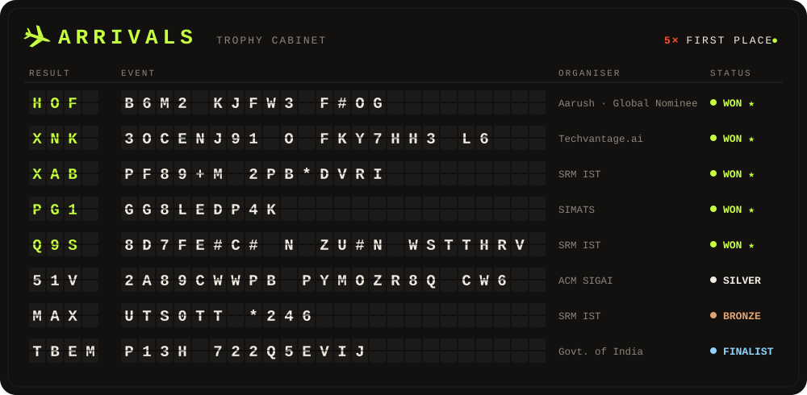

  
  
  
  
  
  

### ✈️ Pre-flight briefing

AI/ML engineer and B.Tech CSE (AI & ML) student at **SRM IST, Chennai** (CGPA 9.5). I work on **multimodal AI, LLM fine-tuning, audio deepfake detection and RAG**. I've interned at **Samsung R&D Institute Bangalore** and **Introspect Labs**, and I've won **five hackathons**.

> *"I don't wait for the perfect idea. I build a rough one fast and fix it before the demo."*

---

### 🎫 Flagship builds · now boarding

<table>
  <tr>
    <td width="50%" align="center">
      
      <a href="https://laksh718.github.io/Deepshield"><b>Case study ↗</b></a> · LightGBM · Librosa · SHAP
    </td>
    <td width="50%" align="center">
      
      <a href="https://janrakshak.web.app/"><b>Live ↗</b></a> · <a href="https://github.com/Laksh718/janrakshak">Code</a> · TypeScript · Firebase · Supabase
    </td>
  </tr>
  <tr>
    <td width="50%" align="center">
      
      <a href="https://hindsightx.vercel.app"><b>Live ↗</b></a> · <a href="https://github.com/Laksh718/hindsight">Code</a> · TypeScript · Hono · web-search agent
    </td>
    <td width="50%" align="center">
      
      <a href="https://huggingface.co/spaces/Laksh718/Daedalus-Env"><b>HF Space ↗</b></a> · Qwen2.5 · QLoRA · GRPO · OpenEnv
    </td>
  </tr>
  <tr>
    <td width="50%" align="center">
      
      <a href="https://bionaut.vercel.app"><b>Live ↗</b></a> · <a href="https://github.com/Laksh718/BioNaut">Code</a> · LLM · RAG · 3D graph
    </td>
    <td width="50%" align="center">
      
      <a href="https://kavach-beta.vercel.app"><b>Live ↗</b></a> · <a href="https://github.com/Laksh718/Kavach">Code</a> · React Native · FastAPI · XGBoost
    </td>
  </tr>
</table>

### 🛫 The rest of the hangar

| Build | What it does | Stack | Links |
| --- | --- | --- | --- |
| **FeedForward** | Forecasts hostel-mess meal demand as a low / likely / high range, so kitchens cook the right amount | Python · cVAE · NLP | [Live](https://laksh718.github.io/FeedForward/) · [Code](https://github.com/Laksh718/FeedForward) |
| **Oviora** | AI copilot for PCOS and hormonal health, with 7 ML + LLM engines and explainable output | Python · ML · LLMs | [Live](https://oviora-seven.vercel.app) · [Code](https://github.com/Laksh718/Oviora) |
| **SignLang → Text & Speech** | Real-time American Sign Language recognition from a webcam, read aloud | Python · CNN · OpenCV · TTS | [Demo](https://youtu.be/mnpAdZGfyAI) · [Code](https://github.com/Laksh718/SignLang-To-Text-And-Speech) |
| **VaxMap** | GeoAI research (UROP) that maps vaccination cold spots across Indian districts | GeoPandas · QGIS · Folium | private research repo |
| **Career Copilot** | Android app with an autonomous opportunity pipeline and a Gemini career coach | Flutter · Dart · Gemini | [Live](https://laksh718.github.io/Career-Copilot/) · [Code](https://github.com/Laksh718/Career-Copilot) |
| **Surface Reset Portal** | 3D digital twin of a 6-station car-reconditioning line for CARS24, taking 22.6 s per car | Three.js · Simulation | [Live](https://laksh718.github.io/cars24/) · [Code](https://github.com/Laksh718/cars24) |
| **LokSetu** | Civic grievance portal where citizens report, workers resolve and admins track, with auto-escalation | React · Node · MongoDB | [Live](https://loksetu.web.app) |
| **BharatAssist IT** | AI IT helpdesk with ticketing, smart routing and a support chatbot | React · TS · Supabase | [Live](https://bharatassist-it.web.app) · [Code](https://github.com/Laksh718/BharatAssistIT) |
| **Answer Arena** | Tech quiz arena with profiles, live progress and a results breakdown | React · TS · Vite · Tailwind | [Code](https://github.com/Laksh718/Answer-arena-game) |
| **SRTF Visualiser** | Step-by-step animation of Shortest-Remaining-Time-First CPU scheduling | JavaScript | [Live](https://srtfvisualiser.vercel.app) · [Code](https://github.com/Laksh718/SRTF-Visualiser-Team-13) |
| **DNA Sequence Classifier** | Sorts DNA sequences into 7 protein classes using k-mer features | scikit-learn · RF · KNN | [Code](https://github.com/Laksh718/DNA-Sequence-Classifier) |
| **Identity Reconciliation** | Links orders placed with different emails and phones back to one customer | Node · TS · PostgreSQL | [Code](https://github.com/Laksh718/identity-reconciliation-service) |

Every repo is in the archive at <a href="https://www.laksh.codes/projects/">laksh.codes/projects</a> ↗

---

### 🧭 Logbook

**🟥 Samsung R&D Institute Bangalore**, PRISM AI/ML Intern · *Jul – Nov 2026*
Built **DeepShield**, an explainable deepfake-speech detector. I benchmarked 10+ models, and a tuned LightGBM reached **93.2% accuracy** and went to production. Every verdict comes with SHAP explanations and a calibrated confidence score.

**⬛ Introspect Labs**, Gen AI Intern · *Sep – Nov 2026*
Worked on a multimodal video-understanding and RAG platform (Qdrant, FastAPI, PostgreSQL, FalkorDB). I raised scene-search **Recall@1 from 37% to 43%** and **Recall@3 from 50% to 58%** without making any existing search worse. I also shipped scene summarisation and cast retrieval.

**🟩 SRM IST**, Research Intern (UROP) · *Sep 2025 – Oct 2026*
Researched **VaxMap**, a GeoAI system that maps vaccination coverage across Indian districts. The work used GeoPandas data fusion, QGIS hotspot/cold-spot analysis and Folium choropleths.

---

### 🏆 Arrivals

Also: **NASA Space Apps Global Nominee** · **Meta PyTorch OpenEnv × Hugging Face Grand Finale** (800 of 31,000+ teams) · **BNY Spectrum** (62 selected of 1,563)

---

### 🧰 Toolbox

   
   
  

  
  
  
  
  
  
  
  
  
  
  

📜 SAP Generative AI Developer · OCI AI Foundations Associate · Oracle AI Agent Studio Foundations · NPTEL Elite + Silver

---

### 📡 Flight data

  
  

  

<picture>
  <source media="(prefers-color-scheme: dark)" srcset="https://raw.githubusercontent.com/Laksh718/Laksh718/output/github-snake-dark.svg" />
  
</picture>

